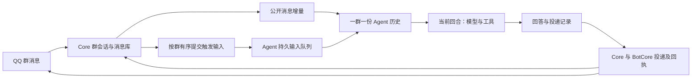

# Eden Agent QQ 群聊共享会话设计

状态：2026-11-06，用户批准文件编辑与测试后已实现 Core／Agent 共享群会话，完成隔离数据联调、回归和三次真实 DeepSeek 调用。源码与当前候选构建已更新；没有迁移真实数据库、重启在线服务或发送真实 QQ。实际验收结果见第 12 节。

## 1. 核心决定

每个账号下，同一个机器人在同一个群使用一条 Agent 会话、一份模型历史、一套压缩检查点。群成员的公开发言和机器人回答共同延续这份历史。操作者、附件和审批的归属随每轮输入保存，不再由会话创建者决定。

首版同群只运行一个前台回合，其他输入按群内接收顺序排队；不同群可并行。普通群消息记录进历史，不因为入库就调用模型。@、名字、关键词和已配置事件继续决定是否触发回答，本次不扩展自主插话策略。

不再采用“每个成员保留一套长期任务历史，再每轮追加整份公共群背景”的结构。工具调用和结果仍是共享 Agent 执行历史的一部分，使用现有模型结果投影减少无关信息；底层完整审计继续由宿主保存。

## 2. 当前源码依据

| 已有能力 | 源码及结论 |
| --- | --- |
| QQBot 会话归属 | `../../../Core/Application/Domain/BOT/Session/Adapters/Django/Persistence/models/session_model.py`：唯一键为 bot、qq_number、is_group；群聊的 qq_number 是群号。 |
| 消息持久化 | 同目录 `message_model.py` 与 `Session/Application/message_usecases.py`：消息属于会话，真实发言人保存在 metadata；同会话外部消息 ID 防重复。 |
| 普通模式共享历史 | `../../../Core/Application/System/AiService/Context/BOTMode/services/Bot/{bot_context,bot_assembler}.py`：按群会话读取历史，以带姓名和 QQ 的 user 消息及 assistant 回复组装。 |
| 普通模式互斥 | `../../../Core/Application/Domain/BOT/Core/services.py` 调用 `serialized_session_turn`；线程锁和文件锁串行生成回答。现有锁不等同于严格按接收顺序的持久队列。 |
| Agent 按成员分叉 | `../../Server/src/modules/qq-channel/group-bridge.ts`：会话查找键包含 operator_qq。 |
| 身份仍来自会话 | `../../Server/src/modules/mon/napcat-client.ts` 从 qq_group_sessions 读取 operator_qq；表情发送当前还可不传 turnId。 |
| 停止与失败范围 | `../../Server/src/modules/sessions/input/input-repository.ts` 存在按整个会话取消、挂起排队输入的路径，共享后必须细分。 |

QQBot 已有的群会话、消息库、成员资料和普通模式摘要可以复用。需要调整的重点在 Agent 会话绑定、增量历史连接和每轮执行身份，不能只从 SQL 查询中删掉 operator_qq。

## 3. 状态与数据所有权

| 状态 | 所有者 | 归属与职责 |
| --- | --- | --- |
| 群公开消息、原消息 ID、原始发送时间、群成员资料 | Core | 一群一份公开记录，普通模式和 Agent 模式共同使用。 |
| 群内输入接收次序与待提交任务 | Core | 与消息接收一并持久登记，按群有序向 Agent 提交；断线后重试同一次登记。 |
| Agent 会话、检查点、模型摘要、原生工具调用链 | Agent | 一个账号／机器人／群对应一个活动会话，不按成员建立分支。 |
| 每轮输入来源、操作者与附件快照 | Agent | 与 accepted input 同事务持久化；工具、状态查询、恢复和投递均读取这份绑定。 |
| 消息导入范围、重复映射、历史覆盖位置 | Agent | 区分已导入、已由摘要覆盖及已与本地回答对应的公开消息。 |
| 个人权限、群准入 | Core | 使用现有好友／用户规则，实际操作时重新校验；正文里的自称不改变权限。 |
| 群权限模式、具体审批、工具执行事实 | Agent | 保留现有模式和审批语义，记录发起人与审批人各自的身份。 |

Core 的公开记录与 Agent 的模型检查点职责不同：前者保存群里实际发生的消息，后者还保存模型执行工具所需的连续记录。它们通过消息映射连接，同一公开消息在模型历史中只出现一次。

建议新增以下业务记录，沿用现有 sessions、inputs、permission_requests 等基础表：

- 群会话绑定：账号、机器人、群、Agent session，活动绑定唯一；不设永久 operator_qq。
- 输入来源绑定：input、turn、群绑定、真实操作者、原消息、接收序号、引用、附件与身份资料快照。
- 历史导入记录：来源消息与 Session entry 的对应关系、摘要覆盖范围、已处理位置；压缩后仍保留去重依据。
- 回答投递记录：本地回答、Core 公开记录及 QQ 回执的对应关系，明确待投递、成功、失败和结果未知。

表名、迁移号在实现时按实际 schema 分配；不使用已有迁移号，不直接改写旧检查点 JSON。账号、世界、机器人、群及输入关联在宿主持久化，不要求模型生成或照抄内部关联值。

## 4. 消息接收、排序与执行



1. Core 保存消息时，确认真实发送者、群和准入，登记它是普通背景还是触发输入。在同一群内分配有序位置；不能用 HTTP 到达先后、客户端时间或不同线程抢锁的顺序代替接收次序。
2. 触发输入进入 Core 的持久待提交记录。每群只有一个有序提交者；收到 accepted 或确认相同输入已接受后，再提交下一个。不同群互不阻塞。
3. Agent 接收时检查账号与机器人、群、消息归属，持久保存输入来源，并防重复。重试返回原 input／turn，不能重新调用模型。
4. 执行器领取本群下一条输入，在模型运行前导入本轮所需的公开消息增量，合并此前已经完成的 Agent 回合。当前问题只追加一次。
5. 本轮开始后冻结本轮历史视图、引用和附件；普通后续发言继续在 Core 入库，新的触发输入继续排队，不插进正在进行的工具调用链。
6. 本轮生成、工具结果与最终回答先持久化，再进入投递路径。前一回合执行结束并保存检查点后，才领取下一回合。

### 两种顺序必须分清

Core 保留实际群消息的时间顺序。Agent 模型历史还要保证每个工具回合完整：assistant 工具调用与对应 tool 结果之间不能插入下一位成员的任务。

例如 B 在 A 运行期间提问：Core 可以记录为 A 提问、B 提问、A 回答；Agent 在 A 完整回合结束后处理 B，使 B 能参考 A 已完成的结果。原发送时间保留，不把 B 的消息伪装成 A 回答后才发送，也不要求两边的所有行物理排列完全相同。尚未轮到的触发问题不作为当前任务提前导入。

### 普通消息与漏页

普通群消息在下一安全回合边界进入共享历史，不单独唤醒模型。当前实现从 Core 按连续消息位置分页同步公共原文，再由 Agent 共用原有分段压缩；不重复引入普通模式的摘要，避免原文与摘要覆盖重叠。单条公共投影沿用 6000 UTF-16 单元上限并明确标记截取，完整原文仍在 Core。

原始镜像游标和模型历史覆盖分别记录：qq_group_history 的同步位置在 SQLite 镜像提交后推进；镜像尚未代表模型已读。运行时把待导入记录以确定的来源 entry ID 原子提交到检查点后才供模型使用。恢复时重扫镜像，已存在的 entry ID 不重复追加；压缩保留原树中的来源依据。同步序号存在缺口时明确失败，不跳过缺口推进游标。

## 5. 每轮操作者与权限

### 稳定身份绑定

每个回合从自己的持久输入来源获得操作者，执行期间不可由下一条群消息覆盖。不在共享 session.environment 中反复写入一个“最新 contactQq”，也不依赖进程全局的当前发言人变量。

身份资料供模型理解；权限始终按宿主规则执行。需要核对的链路包括：

- NapCat 发现、读写动作及执行前后的 assertCurrent，必须带 turnId 查本轮来源。
- 表情、QQ 文件、其他外部通信和结果回传，不能再回退到建会话时的操作者。
- 状态轮询和文件取回，校验请求者与对应 input 的绑定，不能再只查共享会话的一列 operator_qq。
- 创建提醒时保存来源；稍后的 job 使用原创建者／群绑定并重新校验，不能借用触发当时正在聊天的成员。
- 明确重提保留原请求者和引用归属；不因另一个成员当前活跃就改变执行者。

普通成员在群中继续讨论他人的任务，可以理解共享历史，但新发起的操作属于当前成员，需要按当前成员身份重新判断；阅读历史不自动继承原执行者的权限。

### 权限与审批维持现有业务

个人权限沿用未授权、允许聊天、管理员、超级管理员、拉黑；群主／群管理员身份不自动提升为机器人个人权限。群权限模式继续按机器人与群保存，App 和私聊模式不继承到本群。

审批仍引用对应卡片或文字，由本机器人的个人超级管理员处理；一次审批只对应原工具操作。记录“谁发起”和“谁批准”两个事实，管理员批准不能把原操作者替换成管理员。

现有无 OS 沙箱的执行规则保持；共享会话不引入新的文件或网络沙箱，也不以保密为目的改写 QQ 业务 ID。工具结果继续按现有契约减少无关元数据。

## 6. 模型看到的历史

```text
system：
  角色固定身份与资料、通用规则、群聊规则、群默认回复偏好
  可选的现有超限模板及收束提示，按原布局组装

user（有更早压缩历史时）：
  群共享摘要，保留发言人、承诺、任务进展和结果确定程度

user / assistant / tool：
  已保存的群共享历史与完整工具调用链
  用户发言：小明（管理员）（123456789）：……
  本共享运行时的机器人回复使用原生 assistant 角色
  外部普通模式回复与普通群发言作为标明来源的公开背景记录导入

user（发生变化时）：
  运行资料快照；必要的成员权限／称呼变更资料

user（本轮输入）：
  当前提问者：小红（允许聊天）（987654321）
  独立引用、本轮可读附件、必要时间与个人回复偏好（存在时）
  当前消息：用户这次真正提出的问题

assistant / tool：
  本轮回答或工具执行
```

这是当前实现的语义顺序；群资料不整包塞回每轮 system。工具名称、说明、参数仍通过原生 tools 字段提供，QQ 工具目录与现有权限策略保持一致。

每条用户发言保留“名字（权限）（QQ号）”。历史中的姓名和权限表示消息接收时的快照；本轮发言人使用本轮资料。权限后来变化时追加明确的当前状态，不为了刷新名字／权限重写整个历史前缀；旧消息缺失权限显示未知。实际操作时仍实时校验。

引用离开近期窗口后仍可单独带入，带原发言人与原消息 ID。相同原文已在本轮历史时优先保留引用关系，避免再复制长正文。历史附件可帮助理解指代，读文件仍需按现有群引用文件协议解析和建立本轮快照，不能声称旧文件已被再次读取。

runtime-pi 使用公开 SessionTreeEntry／MemorySessionStorage 接口，把外部公开记录导入为 eden.qq.public_message 自定义记录；供应商看到的是明确标注“本群公开记录，仅作对话背景”的 user 内容。当前运行时自身的 assistant／tool 回合保持原生结构，Core 下发回流按 reply_to_input 去重。这样不把普通模式输出伪装成当前模型的生成，也不把成员正文中的角色标记解释成真正的 assistant。Server 不直接导入 pi。

### 6.1 成员轮换与缓存

缓存是共享会话的验收要求。多人共用 session 本身不保证命中；模型实际看到的历史前缀必须延续，且处在供应商允许复用的缓存范围内。

2026-11-06 核对 [DeepSeek 缓存说明](https://api-docs.deepseek.com/guides/kv_cache/)：缓存匹配已持久化的完整前缀单元，追加式多轮对话可以复用此前单元，短公共前缀可能要被单独识别后才能复用；官方不保证每次命中。因此不能把“字符串有相同开头”直接报告成真实命中。

以固定配置 S 和群历史 H 为例，A、B、A 轮换的目标形状为：

```text
A 提问：S + H + [A 的身份、引用、偏好、问题]
B 提问：S + H + [A 的身份、引用、偏好、问题] + [A 的回答] + [B 的本轮输入]
A 再问：S + H + [A 的本轮输入] + [A 的回答] + [B 的本轮输入] + [B 的回答] + [A 的新输入]
```

S 代表固定 system 与同一套工具定义，不表示要把 tools 字段改成消息文本。新问题与原有完整前缀分开；成员名字、权限和 QQ 不同，只改变新追加的部分。

必须遵守以下规则：

1. **本轮输入一旦进入模型，就保存其模型视图。** 姓名、权限、引用、附件引用、时间和个人回复偏好随该输入保留。原始用户正文继续独立保存，不被模型包装覆盖。下一轮不能删除上一轮的身份块，也不能以当前成员的资料重新渲染旧消息。
2. **当前成员资料不进入固定 system。** 群默认回复偏好、角色绑定及模板版本作为群配置稳定使用；A 要简短、B 要详细等本轮差异放入各自输入。角色“当前情境”等动态资料放后部；明确修改人设或模式时记录配置变更，允许前缀重建，不为缓存忽略修改。
3. **保留统一、稳定排序的 QQ 工具定义。** 不因为换人、一次审批或普通加载动作就重排 schema，也不把操作者、调用号和动态时间塞进工具描述。真实的工具策略变化仍生效，接受必要的前缀变化；展示工具不授予执行权限。
4. **不每轮重建整个群背景。** 普通消息、引用关系、权限变更与运行资料按增量追加并保留；不反复改历史名字、日期或摘要。压缩之外不为了维持“最近 N 条”而每轮从开头删除一条。
5. **同群串行提交模型请求。** B 使用 A 已完成并持久化的历史；不同时用不同成员的临时视图覆盖共同前缀。同群共用模型配置与供应商连接，不自动继承各成员私聊的配置。
6. **缓存亲和与真实操作者分开。** 对供应商明确支持的会话亲和键才使用稳定的群会话标识。DeepSeek 的 [user_id 字段](https://api-docs.deepseek.com/api/create-chat-completion/)可以影响缓存隔离；若网关或供应商按真实成员隔离缓存，应尊重该范围，不能承诺跨成员命中或为了缓存伪造用户身份。当前项目适配器没有显式按 QQ 设置该字段，实施时还要核对最终载荷和网关行为。

当前旧实现的 TurnContext 不进入持久检查点：A 当轮附加的公共参考在 B 请求时会消失，新的参考换到 B 输入后。即使 system 不变，也不能保证 A 的整个请求前缀延续。共享新模式必须以持久增量消息替代这条整包临时注入路径；不能只共用 sessionId 后继续沿用它。

角色、模型、工具 schema 或摘要发生真实变化时，部分缓存损失是合理的。压缩用同群统一阈值执行，完成后固定摘要，后续继续追加；不因换成员而压缩或重新总结。不能通过无限保留历史避免压缩，也不能把一次压缩称为永久清空供应商所有缓存。

### 6.2 缓存观测与待验收

现有 `sessions/turn/request-context.ts` 的 promptCacheFingerprint 只覆盖供应商、模型、部分推理配置、system 与 tools，没有比较整段历史，不能用它或 promptCacheEpoch 证明实际命中。

后续必须同时记录：

- 实际发给供应商的 messages／tools，及两次请求从哪个消息／内容位置开始不同；本地字节比较只辅助排查，不伪装成供应商 tokenizer 的精确前缀 tokens。
- 首部配置与 schema 是否一致、供应商连接及缓存范围是否变化、是否刚发生压缩或角色切换。
- 供应商原始 usage 可取得时的 `prompt_cache_hit_tokens`、`prompt_cache_miss_tokens`，以及运行时归一化的 cacheRead／input。缺失原始字段时标记不可得，不能把缺失当成确认零命中。

当前安装的 pi SDK 从命中字段读取 cacheRead，并从 prompt_tokens 中扣除缓存读写量计算 input；统计时不能用 cacheRead 除以 input，也不能把 SDK input 误当输入总量。DeepSeek 原始字段齐全时按 hit / (hit + miss) 统计，报告同时保留原始值与字段映射。

待验收包括同成员 A→A→A 与交替成员 A→B→A 的可比请求，权限／昵称／个人回复长度变化，引用与工具循环，恢复，压缩前后及不同群切换。先用录制请求验证前缀结构，再在明确要求真实测试时记录供应商 usage；本轮没有执行这些测试，不能填写预测的命中率。缓存复用上下文计算，回答仍重新生成，不能把它设计成跨成员直接返回上次答案。

## 7. 一份模型历史、一套压缩

Agent 模式的共享检查点由 Agent 现有运行时统一计量和压缩，包括已投影的工具结果。压缩保留说话者、实际执行结果、未完成事项和引用依据；不能把同群公开历史排除在压缩之外后，又每轮重新注入。

Core 的公共摘要继续服务普通模式和首次引导，Agent 模式不在每个回合同时生成另一份相同历史摘要。普通／智能体切换时按覆盖范围补齐缺口，避免双重压缩成本和摘要重复。模型历史压缩不删除 Core 的原始群记录。

模型上下文有限，不能承诺所有原文永远留在请求里。所有新增材料按实际载荷计入窗口，压缩覆盖范围与消息映射一并持久化；没有成功提交摘要时保留原导入位置。

主人的私人长期记忆、私人日记、私聊和其他群依旧不自动加入。QQBot 普通模式已有的成员记忆作用域可供后续专门设计，本次不顺便开启 Agent 的个人记忆召回。

## 8. 取消、失败和长任务

| 情况 | 目标行为 |
| --- | --- |
| A 取消自己排队的输入 | 仅取消 A 选定的输入，B 的输入保留。 |
| A 停止自己的运行回合 | 中止该回合，记录已执行和未确认的副作用；释放执行占用后继续其他输入。 |
| 超级管理员明确停止整个群 | 停止本群活动及排队请求，作为单独的群管理操作。 |
| 某工具被拒绝或发生可记录的业务失败 | 保留真实结果，结束或继续本轮；不自动挂起其他成员的排队输入。 |
| 检查点提交失败 | 暂停本群执行并保留队列，恢复可靠存储前不继续模型或副作用。 |
| 外部操作结果未知 | 保留未知状态，不因重连、重提或另一人发言自动重放。 |
| 等待审批 | 首版占用本群前台执行位，沿用 150 秒审批超时；其他输入显示排队并可各自撤回。 |

串行方案会让长任务或审批等待影响群内其他提问，这是首版明确接受的取舍。后续若需要聊天不中断，可把明确的长任务移到独立后台工作流，再把进展返回公共历史；本次不同时实现多条前台分支。不同群不能被同一条全局 Promise 链长期阻塞。

当前 SessionService.cancel 和输入失败后的整会话队列处理不能直接沿用到共享群入口。新增按 input／turn 操作，App 会话原有行为保留；恢复时检查旧 worker 已退出或失去执行资格，防止旧回调在下一成员回合里继续发动作。

## 9. 回答投递与防重复

模型生成、交给 Core、QQ 接口确认是三个不同事实。答案、投递状态和公共记录关联持久化，不用一次 HTTP 成功或 WebSocket 下发就宣称 QQ 已送达。

Agent 生成的 assistant 回答已经在共享检查点里。Core 随后投影同一回答或收到 QQ 原生回执时，只补关联和投递状态，不再追加第二条相同回答。未知结果保持未知，不能自动补发。引用映射使用真实收到的 QQ 消息 ID；宿主内部 input／turn 关联不进入模型正文。

一条回答可能对应多段文字、图片卡片或文件，逐项记录实际发出的内容与回执，不能再依靠 reply[:4000] 静默截断并把全文当作群成员已经看到。分页和文件交付采用现有可用能力；无法完整交付时明确记录缺失部分。回流去重按这些实际关联处理，不要求一条模型回答只能对应一条 QQ 消息。

普通模式生成的机器人回答则作为外部公开消息增量导入。两类来源必须区分，不能仅以文字相同删除消息，因为不同成员可能确实发送相同内容。

## 10. 协议、切换与旧数据

共享入口使用 qq-group-turn.v5，内层为 qq-group-shared.v1；availability 声明 qq_shared_history_protocol。旧 v1–v4 和 qq-group-context.v1／v2 继续解释为原成员会话路径。新版 Core 每次入口检查能力，不只在开群时检查。协议字段由 packages/api 校验。

一个群在同一时间只能选择一种活动 Agent 历史模式。已经转为共享会话的群收到旧协议时应明确报版本不匹配，不能悄悄再建立成员分支。升级后的在线旧群也要在入口协商，不能只在第一次开启模式时检查一次。

切换步骤：

1. 新增记录与迁移，不删除旧成员会话、用户消息、任务或附件。
2. 等已有运行、审批和已接受的排队任务结束；切换期间新消息继续在 Core 保存，触发请求持久等待，不进入两套执行器。
3. 为群建立唯一共享会话，从 Core 公共原文和摘要引导，保存切换位置。旧成员工具链保持原记录，不把多条检查点硬拼成一棵 Session 树。
4. 原子切换该群活动路由并处理等待输入；任何阶段失败均保持一种有效路由，重试不重复创建会话或导入消息。
5. 旧会话保留可查看，已有提醒按自己的原绑定继续；不自动重跑旧任务、不补发历史回答。

原有长任务若无限等待，需要通过现有明确停止流程结束后再切换，不能为了迁移冒充已完成。关闭群模式后，未开始的 Agent 任务不偷偷转成普通模式回答；再次开启时明确处理等待队列。机器人切换角色在空闲边界完成，共享对话仍延续，明确保留历史回答角色，不能让排队输入在未确认的情况下更换已冻结的角色或模型。

## 11. 实施拆分与依赖

| 顺序 | 范围 | 完成标准 |
| --- | --- | --- |
| 1 | 输入来源与操作身份 | 保持旧群行为，先让 NapCat、表情、文件、状态、权限、提醒和重提全部能按本轮读取操作者。 |
| 2 | Core 接收次序与持久提交 | 普通消息和触发输入有明确来源位置，乱序 HTTP、断线及重复提交不改变任务次序。 |
| 3 | 一群一会话及输入级取消 | 使用共享 session，按群领取输入；一人失败或取消不清掉其他成员的队列。 |
| 4 | 历史增量和压缩 | 接通普通消息、Agent 输出回流映射、启动引导及压缩覆盖位置；移除整包临时参考，验证成员轮换的前缀延续与真实缓存观测。 |
| 5 | 投递、切换和恢复 | 补齐真实发送状态、混合模式衔接、旧群排空及崩溃恢复，再做运行验收。 |

模块落点：Core 的 Session／Message 用例、群历史服务和 agent_channel；Agent 的 qq-channel 业务 repository、sessions 输入边界、mon／stickers／permissions／memos；共享协议在 packages/api，schema 迁移在 packages/store，公开 SDK 适配在 packages/runtime-pi。

新建群绑定后，现有 memories/scope、mon/sync-worker、self-awake/history-scope 与 role-identity 等依赖 qq_group_sessions 的判断都要覆盖共享群，防止误当成 App 私人会话。群身份查询由明确的 QQ 业务入口提供，运行时通过注入的只读来源查询获得，避免新增跨模块循环依赖或散落 SQL。

不把业务和 SQL 继续堆进 group-bridge 或 session-service；按会话绑定、输入来源、历史导入和投递职责拆分，遵守现有工程规模限制。

## 12. 验收清单与当前状态

下面保留完整验收范围；本轮实际运行结果与边界随后列明：

- A 提问、B 接话使用同一个 Agent session，能看到已完成回答，自己的历史不被公共参考重复一遍。
- 非触发消息不调用模型，下次触发时只导入一次；原文和摘要覆盖范围不重叠。
- A→B→A 交替发言不重写首部或删除前轮输入资料；真实命中率从供应商 usage 取得，不以 session 共享或本地指纹代替。
- 两个群与私聊互不混入；QQ 号与群号碰巧相同也不共用会话。
- 超级管理员 A 结束后，普通成员 B 的工具不能沿用 A 身份；A 的延迟回调、表情和提醒同样不借用 B。
- 权限降级、拉黑、撤销群准入后，历史标签不产生授权；引用审批仍只处理对应操作。
- A 取消、审批超时或业务失败后，B 的队列可继续；存储失败则暂停本群。
- 模型工具循环期间到达新消息，不破坏 assistant／tool 配对，也不提前执行排队问题。
- 接受回执丢失、重复消息、输出回流及重启恢复不重复调用模型、导入记录或发送 QQ。
- 压缩后仍能去重、正确读取引用，保持发言人和结果确定程度；导入位置与检查点失败时可恢复。
- 普通／智能体模式与角色切换不产生两条活动历史；旧会话、旧附件和已有提醒保留。

本轮实际结果：Agent QQ／私聊／提醒／压缩／进程回归 91 项通过；Core 隔离数据库回归 277 项通过，合计 368 项，0 失败、0 跳过。包含新增的共享历史、逐条权限、输入级取消、角色切换、跨进程签名 HTTP、准备中的前序阻塞、接收回执丢失后的按源消息取消、发送中断不重放、长回复逐段回执、提醒创建者和压缩后导入去重。旧协议测试明确继续调用旧成员入口，不冒充共享链路验收。

Core 的真实 0030 迁移在隔离的上一版 schema 上执行，验证原消息顺序回填及迁移模型状态与当前模型一致；Agent 新表也在隔离 SQLite 中实际建库使用。Server TypeScript、架构检查（1461 文件、0 错误）及 Server／runtime worker 当前候选构建通过。测试模型 HTTP 读取修正为流式 UTF-8 解码，消除大段中文跨 chunk 损坏造成的前缀假差异。

真实供应商实验使用已验证的官方 DeepSeek Flash 连接，只读取模型配置，使用全新内存库、合成身份和公开预算材料，关闭推理、temperature=0、输出上限 128 tokens。A→B→A 连续三次成功，逐条断言完整前请求 messages 前缀与 tools 不变。没有向真实 QQ 群发送内容。

| 轮次 | 供应商总输入 tokens | 未缓存 input | cacheRead | 命中比例 |
| --- | ---: | ---: | ---: | ---: |
| A 首问 | 1582 | 1582 | 0 | 0% |
| B 接话 | 1661 | 253 | 1408 | 84.77% |
| A 接续 | 1737 | 201 | 1536 | 88.43% |

总输入按 SDK 的 input + cacheRead + cacheWrite 计算；命中比例按 cacheRead／总输入计算。不是按本地 message 指纹推算供应商命中。SDK 没有配置本次模型价格，usage 中零 cost 不表示实际免费；本次结果也不保证其他长度、压缩后、角色／工具变更时仍有同样命中率。

运行证据：[真实缓存结果](../../.run/logs/qq-shared-live.json)、[Agent 回归](../../.run/logs/qq-shared-agent-all.log)、[Core 回归](../../.run/logs/qq-shared-core-all.log)。可复现入口为 Script/Test/qq_shared_live.ts 与 Core 的 run_napcat_contracts.py。当前构建覆盖 E:/EDEN/.release/current/Agent/source-fix-validation，未更新客户包。

当前落地保留 qq_group_sessions 的旧结构，以 qq_shared_rooms 标记共享群；逐输入操作者存 qq_group_inputs，提醒来源存 qq_memo_origins。Core 新增 history_sequence／conversation_seq／sender_permission 和 QQBotGroupInput 持久票据。发送前持久化 sending，失去送达回执则记 unknown，禁止自动重发；长回复按段记录实际成功回执，不把未送出的全文标成已送达。文件投递另保存事件游标与发送状态。

尚未执行的上线验收：真实 QQ／NapCat 投递、在线 Core 0030 迁移、旧群排空后的实际切换、在线进程重启，以及真实大积压群的延迟与内存观察。当前不存在“测试通过即在线已生效”的结论。
